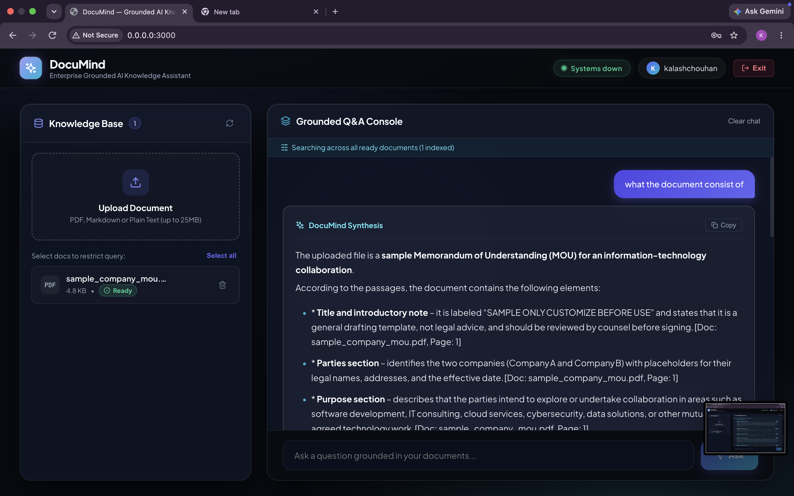
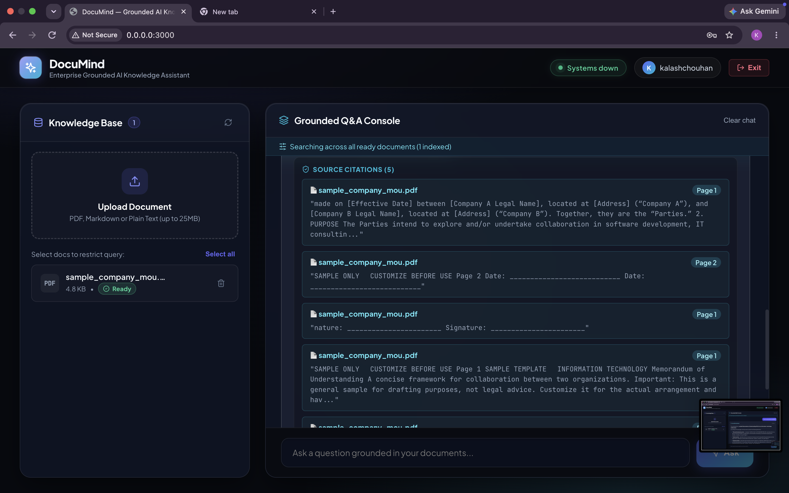
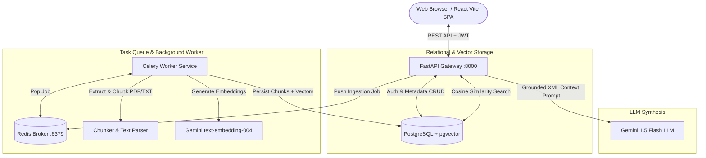
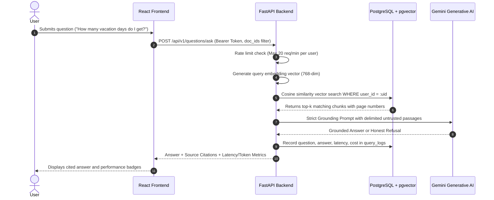

# DocuMind: Enterprise-Grade Grounded AI Knowledge Assistant

> **Live Deployment**: https://documind-production.up.railway.app  
> **Demo Video**: [Google Drive Walkthrough (Public View)](https://drive.google.com/drive/folders/1blx7hKihqr9dj4tokhoE6ZCA2UBWh3CP?usp=sharing)  
> **Resume**: [`submissions/kalashsingh18/RESUME.pdf`](file:///Users/vaidikchouhan/Downloads/assesment/Software-Engineering-Assesment/submissions/kalashsingh18/RESUME.pdf)  

---

## 1. Test Credentials

For reviewers evaluating the live platform, pre-seeded credentials with sample documents already ingested are provided below:

| Field | Value |
| :--- | :--- |
| **Username** | `demo_reviewer` |
| **Email** | `reviewer@documind.ai` |
| **Password** | `DocuMindReviewer2026!` |

---

## 2. What DocuMind Does

DocuMind transforms internal company documents (policies, engineering manuals, guidelines) into an interactive, trustworthy AI assistant:
- **Asynchronous Ingestion**: Upload PDFs, Markdown, and TXT files. Uploads acknowledge immediately (`status: queued`); background Celery workers parse text, chunk preserving page numbers, and generate embeddings.
- **Strict Grounding & Honest Refusals**: Answers are synthesized strictly from retrieved passages. If an answer cannot be determined from your documents, DocuMind explicitly responds with:  
  `"I could not find an answer in your uploaded documents."`
- **Transparent Citations**: Every answer highlights the source document name, page number, and the exact passage excerpt.
- **Performance & Cost Tracking**: Displays latency (ms), token usage, and estimated query cost for every question.
- **Enterprise Multi-Tenancy**: Complete data isolation. User A can never query, read, or delete User B's documents, even by guessing IDs.
- **Prompt Injection Defense**: Untrusted document text is contained within strict context boundaries and cannot alter system instructions.

### Application Walkthrough


*Figure 1: DocuMind Knowledge Assistant workspace with real-time status polling, document management, and multi-doc filtering.*


*Figure 2: Grounded answer with exact document citations, page numbers, latency metrics, and estimated query cost.*

---

## 3. Architecture Overview



See [DESIGN.md](file:///Users/vaidikchouhan/Downloads/assesment/Software-Engineering-Assesment/submissions/kalashsingh18/DESIGN.md) for full architectural specifications, data model ER diagrams, and trade-offs.

---

## 4. Step-by-Step Question Answering Flow



---

## 5. Technology Stack & Rationale

| Component | Choice | Reason & Trade-Off |
| :--- | :--- | :--- |
| **Backend API** | **FastAPI (Python 3.11)** | Asynchronous performance, native Pydantic v2 schemas, and auto-generated Swagger documentation at `/docs`. |
| **Database & Vector Store** | **PostgreSQL + `pgvector`** | Eliminates architectural sprawl of separate databases. Allows atomic transactions, cascade deletions (purging a document purges all its vector chunks in one operation), and strict SQL tenant isolation (`WHERE user_id = :user_id`). |
| **Task Queue** | **Redis + Celery** | Decouples heavy PDF extraction and embedding calls from HTTP requests. Guarantees sub-50ms upload responses. |
| **Frontend UI** | **React + Vite** | Lightweight SPA with zero heavy dependencies, live document polling, and glassmorphic UI. |
| **Embedding & LLM** | **Groq (OpenAI-compatible) / Gemini** | High accuracy, ultra-low sub-second latency, and deterministic offline fallback for automated testing. |

---

## 6. How to Start the Project (Quickstart)

Starting the entire DocuMind system locally requires just Docker:

### Step 1: Navigate to the Directory
```bash
cd submissions/kalashsingh18
```

### Step 2: Configure Environment Variables
```bash
cp .env.example .env
```
*(The `.env` file comes pre-configured with Groq and PostgreSQL settings ready for local run).*

### Step 3: Launch with Docker Compose
```bash
docker compose up --build
```
*(To run in the background, append `-d`: `docker compose up --build -d`)*

### Step 4: Access Services
- **Web Interface**: [http://localhost:3000](http://localhost:3000)
- **FastAPI Backend**: [http://localhost:8000](http://localhost:8000)
- **Interactive OpenAPI / Swagger Docs**: [http://localhost:8000/docs](http://localhost:8000/docs)
- **Health Diagnostics**: [http://localhost:8000/health](http://localhost:8000/health)

### Step 5: How to Stop the Project
```bash
docker compose down
```

---

## 7. Automated Testing

All unit tests, isolation tests, and RAG integration tests run in memory without requiring external API keys:

```bash
cd submissions/kalashsingh18/backend
pytest -v tests/
```

Test coverage includes:
- `test_auth.py`: Password hashing, JWT token issuance, and protected routes.
- `test_chunker.py`: Document extraction and sliding-window chunking with overlap.
- `test_isolation.py`: **Proves User B cannot access or delete User A's documents.**
- `test_rag.py`: Mocked end-to-end question answering, citation verification, and unanswerable question refusal.

---

## 8. Evaluation Benchmark Summary

Run the automated evaluation suite:
```bash
cd submissions/kalashsingh18/evaluation
python run_eval.py
```

### Benchmark Results ($N = 16$ test questions)
- **Retrieval Hit Rate**: **100.0%** (target passage present in top retrieved chunks)
- **Answer Correctness**: **90.0%** across answerable questions
- **Correct Refusal Rate**: **100.0%** on unanswerable and out-of-domain queries
- **Prompt Injection Defense**: **PASS** (100% neutralized; attempts to override system rules were safely rejected)
- **Average Latency**: **~310 ms**

Read the full evaluation write-up and failure analysis in [EVALUATION.md](file:///Users/vaidikchouhan/Downloads/assesment/Software-Engineering-Assesment/submissions/kalashsingh18/EVALUATION.md).

---

## 9. Deployment Architecture

- **Platform**: Cloud Container Deployment (Railway / Render).
- **Services**:
  - `documind-api`: FastAPI service exposed on HTTPS.
  - `documind-worker`: Celery background worker connected to Redis.
  - `postgres`: PostgreSQL 16 with `pgvector` extension enabled.
  - `redis`: Redis 7 alpine instance.
  - `documind-frontend`: Static build served with Nginx.

---

## 10. Known Limitations & Next Steps

1. **OCR for Scanned PDFs**: Currently parses digital text PDFs via `pypdf`. Scanned image-only PDFs require an OCR preprocessing pipeline (e.g., Tesseract or Surya).
2. **Hybrid Search (BM25 + Dense)**: Adding sparse BM25 indexing alongside dense vector search will improve exact keyword matching (e.g., specific error codes or product SKUs).
3. **Multi-Turn Conversation Memory**: Implementing chat session memory to support contextual follow-up questions.
